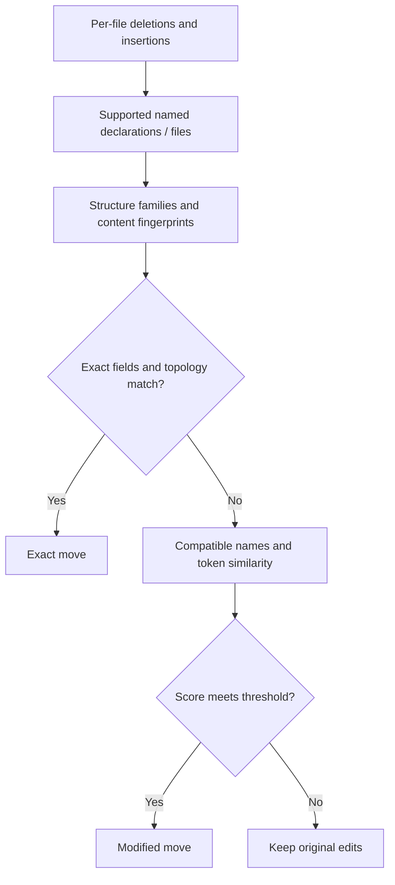

# Cross-file correlation

The engine retains candidate insertions and deletions across a changeset. The correlator recognizes named declaration and whole-file moves, then the human report replaces the paired addition/removal with a move summary. Machine output retains the underlying per-file actions and adds cross-file metadata.

Candidate storage starts with an 8 MiB accounted memory cache. Crossing that limit moves the cache and later candidates to temporary payload/index files. Correlation scans compact metadata and loads only the compared subtrees. Disk I/O failures propagate; sufficient temporary storage is required. A single large candidate and transient token sets can exceed the cache budget.

## Try an exact move

Create these four files under `old/` and `new/`. Both snapshots contain a utility
module and a pricing module. Only the location of `formatPrice` changes:

```typescript old/src/utils.ts
export function formatPrice(price: number): string {
  return "$" + price.toFixed(2);
}

export const TAX_RATE = 0.08;
```

```typescript new/src/utils.ts
export const TAX_RATE = 0.08;
```

```typescript old/src/pricing.ts
export const CURRENCY = "USD";
```

```typescript new/src/pricing.ts
export const CURRENCY = "USD";

export function formatPrice(price: number): string {
  return "$" + price.toFixed(2);
}
```

```bash
differens old/ new/
```

```text

  cross-file moves:
  → function `formatPrice` from src/utils.ts to src/pricing.ts

1 cross-file move
```

Now keep the function name but change its currency prefix in `new/src/pricing.ts`:

```typescript new/src/pricing.ts
export const CURRENCY = "USD";

export function formatPrice(price: number): string {
  return "USD " + price.toFixed(2);
}
```

Use LLM output to see the modified-move marker:

```bash
differens old/ new/ --format=llm
```

```text
differens/1 2 files 1 changes 1 named
# cross-file
> formatPrice src/utils.ts -> src/pricing.ts edited
```

The LLM `edited` marker (or JSON `modified: true`) tells you the destination
differs from the source. Similarity supports this pairing; it does not establish behavioral equivalence. Moving and
renaming the declaration together may leave two unpaired edits instead.

## Candidate selection



Only supported insertion/deletion candidates enter this process. It does not
bucket every node in every source file, and fingerprint equality still requires
verification.

## Exact matching

Candidates are collected in deterministic input order and bucketed by structure fingerprint. Exact content fingerprints nominate candidates. Full content and topology verification establishes an exact move; collisions never establish identity on their own. Whole files can match identical source contents even when path labels differ.

An unlabeled export wrapper can expose its named declaration. Generic syntax fragments and local variables inside named declarations are excluded. Source and destination files must differ, and each action can participate in at most one move.

## Modified matching

When no exact candidate is found, the correlator compares lowercased token sets with Jaccard similarity:

```text
J(A, B) = |A ∩ B| / |A ∪ B|
```

The default threshold is 0.6. Modified declaration candidates must retain the same declaration name; file renames score content without path tokens. A changed structure can prevent a candidate from entering the same family. More than 64 candidates are filtered by name and skipped if still ambiguous.

Selection is greedy and deterministic in input order; it is not a global assignment optimizer or a proof of behavioral equivalence. A move plus a declaration rename may remain an addition/removal if identity is not sufficiently supported. Unmatched edits keep their original per-file meaning.

## Stable identities

`CrossFileMatch` contains `ActionId { file, action }` values referencing the original ordered inputs. Reports use these IDs to remove only the paired human entries. Repeated names or identical bodies do not make unrelated actions interchangeable.

See the [correlate reference](/reference/correlate.html) for Rust types and [machine outputs](/guides/machine-outputs.html) for report schemas.

## From matches to reports

| Match field | Meaning |
| --- | --- |
| `node` | Named declaration or file at the destination |
| `from_file`, `to_file` | Original source and destination paths |
| `modified` | Whether this is a similarity match rather than an exact match |
| `similarity` | `1.0` for an exact match; token similarity otherwise |
| `deletion`, `insertion` | Stable file/action IDs for the paired edits |

The correlator returns `CrossFileMatch` records, not replacement actions. The
engine uses those IDs when presenting a human report. Machine consumers keep the
original actions and can inspect `crossFileMoves` separately. A whole-file match
renders as a file rename; an unlabeled export wrapper can expose its function's
name for a declaration move.
