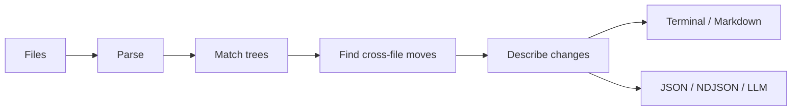

# Introduction

Differens explains code changes by name: renamed functions, moved declarations,
and changed configuration values. Run it on files, directories, or a Git changeset.

## See what a rename looks like

The function below keeps its body and gets a clearer name:

<CodeGroup>

```typescript before.ts
export function computeTotal(prices: number[]): number {
  return prices.reduce((total, price) => total + price, 0);
}
```

```typescript after.ts
export function calculateTotalAmount(prices: number[]): number {
  return prices.reduce((total, price) => total + price, 0);
}
```

</CodeGroup>

Compare the files:

```bash
differens before.ts after.ts
```

```text
  ~ renamed function `computeTotal` to `calculateTotalAmount`
```

That's the change: one function renamed, with its body intact. For comparison,
a line diff shows the text that was replaced:

```diff
- export function computeTotal(prices: number[]): number {
+ export function calculateTotalAmount(prices: number[]): number {
    return prices.reduce((total, price) => total + price, 0);
  }
```

Differens parses the files and matches their structure to recognize the function.
When you change its body or parameters too, those edits appear alongside the
rename. The [quickstart](/getting-started/quickstart.html) walks through that case
with runnable files and output.

## Follow code between files

Suppose `src/utils.ts` and `src/pricing.ts` both exist. You move `formatPrice`
from the first file to the second, leaving the other declarations in place.
Compare snapshots of the two directories:

```bash
differens old/ new/
```

```text

  cross-file moves:
  → function `formatPrice` from src/utils.ts to src/pricing.ts

1 cross-file move
```

The report connects the removal and addition into one move. You can compare a
whole Git changeset the same way with `differens main..feature`.

Modified moves are supported too: the declaration must keep its name and pass
the similarity check. Moving and renaming a function at the same time may leave
an addition and a removal. A reported move describes the matching evidence;
review the source to check behavior.

## Read configuration edits by name

Changing a nested value does not require reading the whole document:

<CodeGroup>

```json before.json
{"database":{"pool":{"max":10}}}
```

```json after.json
{"database":{"pool":{"max":25}}}
```

</CodeGroup>

```bash
differens before.json after.json
```

```text
  ~ changed value of leaf `max` from `10` to `25` in object `pool`
```

JSON, JSONC, JSON5, YAML, TOML, INI, and environment files use structured data
adapters. Scalar types matter: changing numeric `1` to string `"1"` is a change,
even though the displayed characters look similar.

## Give an agent a compact change report

Use `--format=llm` to include names and source lines. For the function rename above:

```bash
differens before.ts after.ts --format=llm
```

```text
differens/1 1 files 1 changes 1 named
# before.ts
~ function calculateTotalAmount :1 computeTotal -> calculateTotalAmount
```

An agent can start with the named change, then read the surrounding source to
review it. Differens runs parsing, matching, and narration locally; generating
this report does not call a model.

The five formats serve different workflows:

| Format | What you get |
| --- | --- |
| `terminal` | Readable summaries for the command line; the default |
| `markdown` | File headings and bullets for a review description |
| `llm` | Compact summaries with source locations |
| `json` | Individual typed actions, node metadata, and context |
| `ndjson` | File records streamed in order, followed by any cross-file moves |

The same rename in Markdown looks like this:

```bash
differens before.ts after.ts --format=markdown
```

```markdown
## before.ts

- renamed function `computeTotal` to `calculateTotalAmount`
```

See [machine outputs](/guides/machine-outputs.html) for the JSON shapes, streaming
records, and source-coordinate conventions.

## Where it helps

### Code review

Start with named changes to see which functions, classes, or settings need
attention. Related body edits are grouped under their declaration. Use the source
or a line diff when you need the exact text behind a summary.

### Refactoring across files

Compare a whole changeset to find supported declaration and file moves, including
moves with edits. Helper extraction appears as a new helper and edits to the
original declaration; the [Go example](/languages/go.html) shows that report.

### AI agents and coding assistants

Use `--format=llm` for an overview with source locations, or JSON when an
integration needs the original actions. The output gives an agent specific names
and files to investigate without asking it to reconstruct every change from hunks.

### PR descriptions and changelogs

Run `differens main..feature --format=markdown` for a starting draft grouped by
file. Review the result and add the reason for the change, which syntax matching
cannot tell you.

### Config and data reviews

Read named keys and values in structured files. Type changes, nested YAML edits,
and markup attributes such as `href` remain visible in the comparison.

### Docs and prose

Plain text and logs support word edits and paragraph moves. Markdown uses line
comparison. Source code, data, markup, prose, raw text, and binary files each have
an adapter suited to their content; see the [tier guide](/languages/tiers.html).

### CI and automation

JSON and NDJSON expose deterministic actions for scripts to inspect. Comparisons
with changes exit zero; your script decides which changes should fail a check.
For reports through `git diff`, [install the Git driver](/guides/git-integration.html).

## How it works

1. Parse each file with its code, data, markup, or text adapter.
2. Match the trees to find updates, additions, removals, and moves.
3. Correlate additions and removals across files to find supported moves.
4. Describe the edits and format the report for a person or a program.



The native Rust CLI includes grammars for sixteen languages, including JavaScript,
TypeScript/TSX, Python, Rust, and Go. Run `differens languages` to check the
extensions in your build. Unsupported formats and inputs that exceed semantic
analysis budgets use line comparison. Read the [language guide](/languages/overview.html)
for coverage and the [architecture](/how-it-works/architecture.html) for the details.

## Try it on your own changes

[Install Differens](/getting-started/installation.html), then run it inside a Git
repository to compare staged, unstaged, and untracked files against `HEAD`:

```bash
differens
```

Or choose the inputs yourself:

```bash
differens before.ts after.ts        # two files
differens old/ new/                  # two directories
differens main..feature              # a commit range
```

Follow the [quickstart](/getting-started/quickstart.html) for a complete first run,
or use the [CLI reference](/reference/cli.html) to choose formats and configuration.
