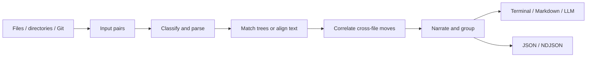

One Cargo monorepo contains six libraries, a native CLI, and Rust maintenance tooling.

```text
apps/cli -> differens-engine -> differens-tiers -> differens-core
                            -> differens-narrate -> differens-core
                            -> differens-correlate -> differens-core
         -> differens-git
xtask: fixtures, benchmarks, docs, and package checks
```

The Git/filesystem layer produces `FilePair` values with original bytes and explicit presence. The engine uses a reusable native thread pool to diff bounded windows while preserving input order. Tier routing chooses parsers from file paths and content; parser output uses the same immutable arena tree representation. The core computes edits; narration describes them; correlation recognizes cross-file candidates.

## Follow a comparison through the pipeline



### 1. Collect file pairs

`differens-git` reads original bytes and records each side's path and presence.
Git inputs use the installed Git executable; directory and standalone file inputs
also work outside a repository. Missing files remain distinct from empty files.
Read failures propagate instead of becoming empty content.

### 2. Classify and parse

`differens-tiers` selects an adapter from the file path. Code uses linked
Tree-sitter grammars and semantic mappings; data and markup use format parsers.
Those adapters build immutable `Tree` arenas for the shared matcher. Raw lines
and prose use the shared sequence engine to produce the same action types.
Original-byte comparison catches unchanged content before parsing.

For example, `.ts` uses the code adapter, `.json` uses data, `.html` uses markup,
`.txt` uses prose, and `.md` uses lines. Unsupported or over-budget semantic
analysis falls directly to lines. See the [tier pipeline](/how-it-works/tier-pipeline).

### 3. Match trees

`differens-core` anchors equal subtrees, recovers related declarations and
containers, and emits `Update`, `Move`, `Delete`, and `Insert` actions. A sibling
reorder is a `Move`; there is no separate `Reorder` variant. Identity hints keep
same-named Go methods on different receivers in separate matching scopes.

The matcher verifies fields and topology after fingerprint lookup. Hash equality
alone cannot establish that two subtrees match. The
[matching walkthrough](/how-it-works/tree-matching) shows an example.

### 4. Correlate across files

`differens-correlate` examines candidate deletions and insertions across the whole
changeset. It verifies exact moves and scores compatible modified candidates.
Human reports combine the paired edits into a move; JSON and NDJSON retain the
per-file actions and add cross-file summaries. One file pair alone cannot reveal
a move into another file.

### 5. Narrate and group

`differens-narrate` describes typed edits using deterministic templates. Canonical
concepts make Rust `fn`, Python `def`, and Go `func` declarations read as
"function". Related body edits can be grouped under a named declaration for human
reports. No model is called to produce these descriptions.

### 6. Write the report

The engine preserves file order while a native worker pool analyzes bounded
windows. Terminal and Markdown favor readable groups. LLM output adds source
locations to compact descriptions. JSON exposes individual actions; NDJSON emits
ordered file records and a final move trailer when needed.

## Why share the matcher?

An adapter defines the tree shape and labels for its format. The core does not
need language-specific parsing rules, so a parser can improve without creating
another matching algorithm. Useful labels and retained syntax still determine
what the matcher can recognize; all adapters do not produce equal-quality results
for every construct.

A Rust caller can build trees directly with `TreeBuilder`, or use
`diff_with_tier` to parse bytes. See the [core](/reference/core) and
[tiers](/reference/tiers) references for runnable Rust examples.

## Ownership

Each tree owns a flat postorder node arena. Actions carry `NodeRef` values sharing one `Arc<Tree>` owner. Matching state is separate. Parser state remains local to worker threads. Each worker reuses its parsers and a bounded parse cache within that thread.

Shallow projections keep update/move metadata compact on the wire while preserving internal tree identity. Insertions/deletions can retain subtrees for correlation. Candidate subtrees detach from unrelated tree nodes. An accounted 8 MiB cache spills to indexed temporary storage when exceeded; correlation loads candidates on demand. Source windows use a soft 64 MiB budget across at most 24 files, so one large file can exceed it.

## Failure boundaries

Git/ref/read errors propagate. Missing files are explicit presence values, not failed reads converted to empty content. Unsupported, malformed, or over-budget semantic inputs fall back to raw lines; invalid UTF-8 remains binary bytes. Fallback diagnostics are distinct from successful semantic matches.

Tree-sitter's runtime and generated grammar scanners are native upstream C/C++ dependencies linked through Rust. Rust owns first-party application code and tooling; it does not replace those parsers with new language implementations.

## Distribution and documentation

The CLI links its selected grammars at build time. Core-only library consumers avoid the grammar dependency graph. `cargo doc --workspace --no-deps` builds API documentation; `cargo xtask docs` generates Mintlify MDX pages from CommonMark sources and an optional static HTML preview. Mintlify deploys the checked-in MDX pages using `apps/docs/docs.json`. The Rust generator does not require Node; Mintlify's preview and validation tools do.
