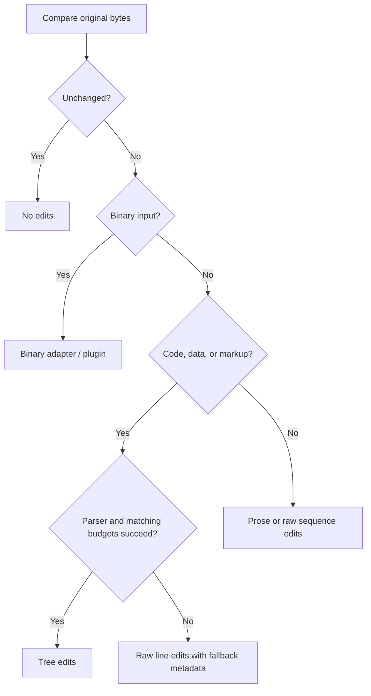

Classification picks an initial adapter from the file path. The router compares original bytes first, distinguishes missing files from empty files, and uses binary handling for invalid UTF-8. It does not walk every numbered tier in sequence.

| Tier | Input | Result |
| --- | --- | --- |
| T5 | Registered code dialect | Tree-sitter CST and semantic concepts |
| T4 | JSON/JSONC/JSON5, YAML, TOML, INI, ENV | Typed key/value tree |
| T3 | HTML/XML and related markup | Elements, attributes, text |
| T2 | Plain prose and selected extensionless documents | Word edits and paragraph moves |
| T1 | Other text, including Markdown | Raw line edits |
| T0 | Binary bytes | File-level changes or plugin result |

## What each tier does

### T0: original binary bytes

Binary extensions and undecodable UTF-8 use byte comparison. Different bytes
remain different even when file lengths agree. The default report states the
old and new lengths; it does not infer what changed inside an image or archive.
In-process `BinaryDiffPlugin` implementations can supply format-specific actions.
No image, EXIF, or executable-symbol plugin is bundled.

### T1: raw lines

Markdown, line-oriented formats, unknown text, and semantic fallbacks use line
alignment. Equal boundaries are trimmed first. Small inputs use exact LCS;
larger inputs use bounded Myers work and unique unchanged anchors when that
budget runs out. This avoids turning every large input into one whole-file edit,
but it does not promise the smallest possible edit script.

### T2: prose words and paragraphs

Plain text and logs use paragraph matching. A changed paragraph is compared at
the word level; an unchanged paragraph can move as a unit. Paragraphs split on
blank lines. Markdown stays at T1 because its lines carry formatting structure.

### T3: markup elements and attributes

HTML/XML and related formats become element trees with ordered text and
attributes. The parser retains attributes such as `href`, including attributes
that do not name the element. It scans quoted values without treating an embedded
`>` as the end of the tag. Malformed input may still produce a partial structure;
this parser is not a browser's HTML conformance checker.

### T4: typed data

JSON/JSONC/JSON5, YAML, TOML, INI, and environment files become typed keys, values,
and containers. Numeric `1` and string `"1"` stay distinct. YAML uses a format
parser rather than a two-space indentation rule. TOML datetimes remain scalar
strings; non-finite numbers use explicit fallback rather than becoming null.

### T5: code structure and semantic names

Linked Tree-sitter grammars parse concrete syntax. Rust match arms map grammar
kinds to concepts such as `Function`, `Class`, `Method`, and `Import`, then recover
declaration names. JavaScript/JSX, TypeScript, and TSX use their own linked
grammars. Unmapped nodes in supported grammars retain their raw CST kinds.

Tree-sitter may retain error nodes in a malformed source tree and still provide
useful structural comparison. An unsupported extension, failed parse, or analysis
budget can instead select raw lines. Merely having a Tree-sitter grammar somewhere
on disk does not enable it in the installed binary.

## Classification rules

| Path or content | Initial handling |
| --- | --- |
| A binary extension, or failed UTF-8 decoding | Binary bytes |
| `.md`, `.mdx`, `.rst`, `.adoc`, `.org`, `.csv`, `.tsv`, `.graphql` | Raw lines |
| `.txt`, `.log`, or selected extensionless document names | Prose |
| `.html`, `.htm`, `.xml`, `.svg`, `.xaml`, `.plist` | Markup |
| `.json`, `.jsonc`, `.json5`, `.yaml`, `.yml`, `.toml`, `.ini`, `.cfg`, `.env`, `.env.local` | Data |
| A recognized code extension | Code classification; linked grammar checked separately |
| Other text | Raw lines; a NUL in the inspected prefix also selects binary |

Classification follows the path, not content guessing. JSON stored in a `.txt`
file receives prose comparison. `classify_file` reports the initial tier;
`is_parseable` checks semantic parser availability, and `diff_with_tier` reports
the tier actually used.

## When semantic parsing falls back

Code routing allows at most 1,000,000 source bytes on each side before falling
back, and semantic tree matching uses a 50,000-node limit per tree. Parsers also
have depth and construction limits. These are analysis limits; the inputs are
still compared with lines. The CLI reports fallback notes on stderr, with
additional metadata in changeset JSON and file NDJSON records.

Adapters build `differens_core::Tree` through validated `TreeBuilder` calls. Shared matching remains in the core; format-specific extraction remains in the tiers crate.
